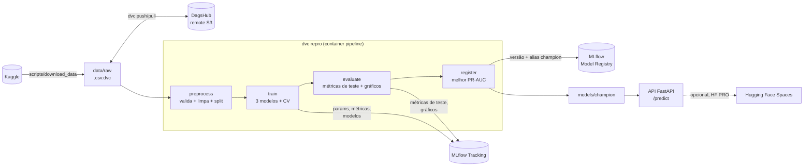
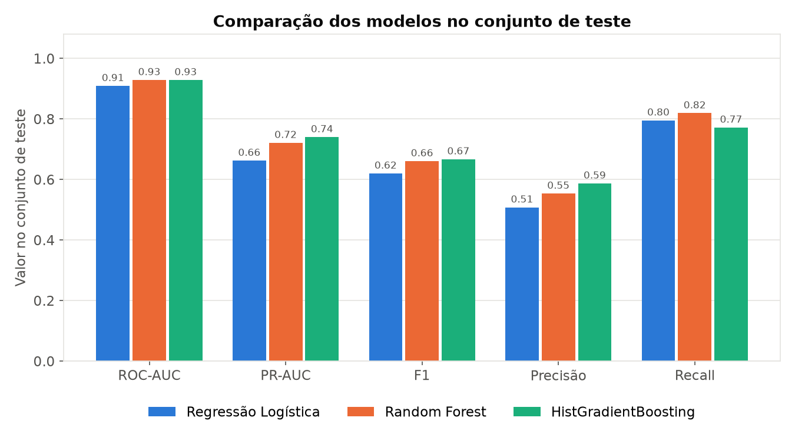
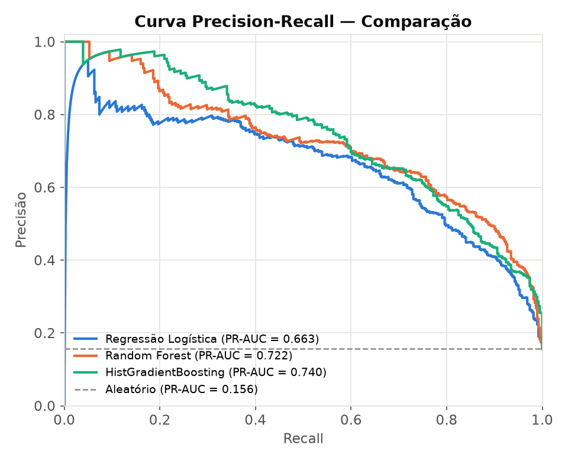
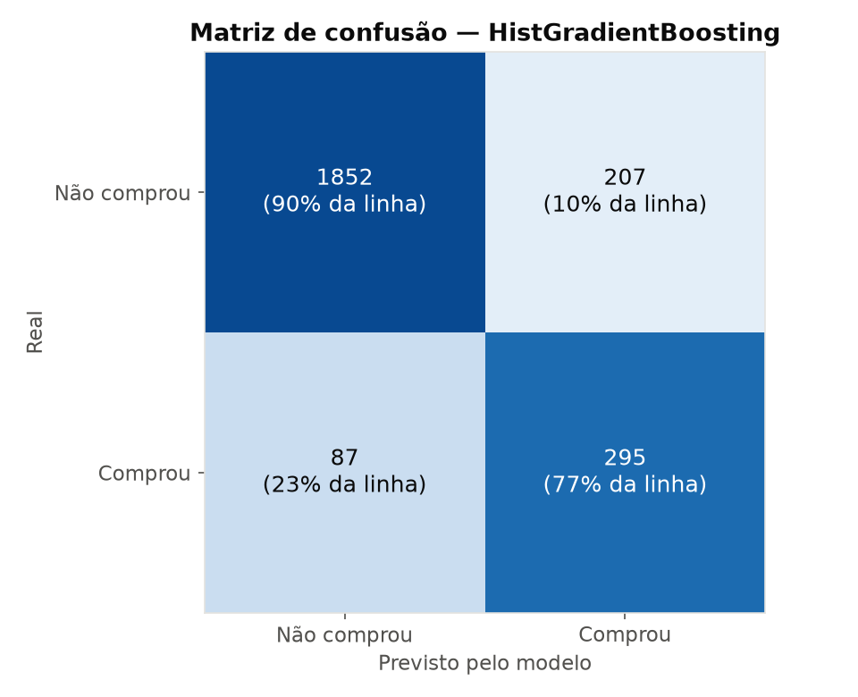

# Propensão de Compra — MLOps

[](https://github.com/joao-victor-galvao/propensao-compra-mlops/actions/workflows/ci.yml)


Tech Challenge Fase 2 — FIAP Pós Tech **Machine Learning Engineering (11MLET)**.

Um e-commerce quer saber **quais sessões de navegação vão terminar em compra**. Este repositório entrega um
pipeline de Machine Learning **reprodutível de ponta a ponta**. O foco é a engenharia, não a complexidade do modelo:

| Pilar | Como foi resolvido |
|---|---|
| Clean Code | `src/` layout, módulos curtos, funções ≤ ~20 linhas, type hints + `mypy --strict`, Ruff (lint, docstrings, complexidade ≤ 6) |
| Reprodutibilidade | Poetry com `poetry.lock`, Python 3.12 fixado, seed única no `params.yaml`, `.env` para configuração |
| Docker | `Dockerfile` multi-stage (Poetry só no build, usuário não-root) + `docker-compose` com MLflow, pipeline e API |
| DVC | Dataset versionado, remote no DagsHub, `dvc.yaml` com 4 estágios e cache por dependência |
| MLflow | Tracking de params/métricas/modelos, linhagem (versão dos dados e commit), Model Registry com alias `champion` |
| Modelagem | 3 classificadores Scikit-Learn comparados por validação cruzada estratificada |

---

## Sumário

- [Dataset](#dataset)
- [Arquitetura](#arquitetura)
- [Como rodar](#como-rodar)
- [Pipeline DVC](#pipeline-dvc)
- [MLflow e Model Registry](#mlflow-e-model-registry)
- [Resultados](#resultados)
- [API de inferência](#api-de-inferência)
- [Qualidade e CI](#qualidade-e-ci)
- [Estrutura do repositório](#estrutura-do-repositório)
- [Decisões de engenharia](#decisões-de-engenharia)

## Dataset

[Online Shoppers Purchasing Intention](https://www.kaggle.com/datasets/henrysue/online-shoppers-intention)
(UCI ML Repository #468): **12.330 sessões** de um e-commerce, cada uma de um usuário diferente, ao longo de um ano.

- **Alvo:** `Revenue`, ou seja, se a sessão terminou em compra (**15,6% positivos**, classes desbalanceadas)
- **10 numéricas:** páginas e tempo por tipo (administrativa, informativa, produto), `BounceRates`, `ExitRates`, `PageValues`, `SpecialDay`
- **7 categóricas/booleanas:** `Month`, `OperatingSystems`, `Browser`, `Region`, `TrafficType`, `VisitorType`, `Weekend`

Após remover 125 duplicatas, restam 12.205 sessões, divididas em 80/20 de forma estratificada (9.764 treino / 2.441 teste).

## Arquitetura



## Como rodar

### Pré-requisitos

- [Docker](https://docs.docker.com/get-docker/) com Docker Compose 2.24 ou superior
- Para rodar fora do Docker: Python 3.12 e [Poetry](https://python-poetry.org/docs/#installation) 2.x
- Para baixar os dados versionados: token do DagsHub (*Your Settings → Tokens → Default Access Token*)

### 1. Clonar e configurar

```bash
git clone https://github.com/joao-victor-galvao/propensao-compra-mlops.git
cd propensao-compra-mlops
cp .env.example .env   # preencha DAGSHUB_USER e DAGSHUB_TOKEN (no PowerShell: Copy-Item .env.example .env)
```

### 2. Instalar as dependências (do zero, a partir do lock)

```bash
poetry install                     # produção + dev
poetry install --only main         # só produção
```

### 3. Baixar os dados versionados

```bash
poetry run dvc remote modify --local origin access_key_id <DAGSHUB_TOKEN>
poetry run dvc remote modify --local origin secret_access_key <DAGSHUB_TOKEN>
poetry run dvc pull
```

> Alternativa sem DagsHub: `scripts/download_data.sh` (ou `.ps1` no Windows) baixa o CSV original pelo
> Kaggle CLI (`pip install kaggle` e credenciais em `~/.kaggle`). O arquivo é idêntico, então o DVC o reconhece
> pelo hash.

### 4a. Rodar tudo com Docker (recomendado)

```bash
docker compose up -d mlflow                                                       # MLflow em http://localhost:5000
docker compose run --rm pipeline dvc repro -f -s preprocess train evaluate register   # treina e registra
docker compose up -d --build api                                                  # API em http://localhost:8000/docs
```

> **Por que forçar (`-f`) na primeira execução?** Depois do `dvc pull`, o DVC já tem os resultados do
> `dvc.lock` e diria que está tudo em dia, sem executar nada. O servidor MLflow, porém, começa vazio. Forçar os
> quatro estágios (`-s` deixa de fora o arquivo bruto versionado) recria as runs e o Model Registry. Nas
> execuções seguintes basta `docker compose run --rm pipeline`, que roda só o que mudou.

O container `pipeline` monta o repositório em `/app`, então `dvc.lock`, `reports/` e `models/` são atualizados
no seu diretório.

### 4b. Rodar localmente com Poetry

```bash
docker compose up -d mlflow           # ou remova MLFLOW_TRACKING_URI do .env para usar sqlite:///mlflow.db
poetry run dvc repro -f -s preprocess train evaluate register
poetry run uvicorn purchase_propensity.api.main:app --reload
```

### Comandos úteis

| Objetivo | Comando |
|---|---|
| Ver o grafo do pipeline | `poetry run dvc dag` |
| Ver o que mudou | `poetry run dvc status` |
| Comparar métricas com o último commit | `poetry run dvc metrics diff` |
| Rodar um experimento alterando um parâmetro | `poetry run dvc exp run -S train.models.random_forest.max_depth=8` |
| Enviar dados e modelo ao remote | `poetry run dvc push` |
| Testes, lint e tipos | `poetry run pytest`, `poetry run ruff check .`, `poetry run mypy src` |

## Pipeline DVC

Definido em [`dvc.yaml`](dvc.yaml) e parametrizado por [`params.yaml`](params.yaml). Cada estágio declara
dependências de **dados, código e parâmetros**, então mudar um hiperparâmetro do Random Forest reexecuta só
`train → evaluate → register`.

| Estágio | Entrada | Saída | O que faz |
|---|---|---|---|
| `preprocess` | `data/raw/*.csv`, `params.data` | `data/processed/{train,test}.parquet` | valida o schema (falha cedo), remove duplicatas, converte booleanos, split estratificado |
| `train` | `train.parquet`, `params.train` | `reports/train_runs.json` | treina cada candidato com CV de 5 folds e cria uma run no MLflow por modelo |
| `evaluate` | `test.parquet`, runs | `reports/metrics.json`, `reports/plots/` | mede no teste e loga métricas e gráficos na mesma run |
| `register` | `metrics.json`, `params.registry` | `models/champion/`, `reports/champion.json` | escolhe o melhor por PR-AUC, registra versão, aplica alias `champion` e exporta |

## MLflow e Model Registry

- **Experimento** `purchase-propensity`: uma run por modelo candidato, contendo:
  - **params:** modelo, seed, folds e hiperparâmetros
  - **métricas:** `cv_*` (média da validação cruzada) e `test_*` (conjunto de teste)
  - **artefatos:** modelo (formato MLflow + `skops`, com *signature* e *input example*) e gráficos em `evaluation/`
  - **tags de linhagem:** `data_version` (MD5 do dataset no DVC), commit git e tipo de modelo
- **Model Registry:** `purchase-propensity-model`. A cada execução do `register`, o vencedor ganha uma nova versão
  e o alias **`champion`** passa a apontar para ela. Aliases substituem os *stages*, descontinuados
  (*deprecated*) no MLflow 3. A versão recebe as tags `model_type`, `selection_metric` e `selection_score`.
- O modelo é carregável por `models:/purchase-propensity-model@champion` ou, offline, por `models/champion/`
  (rastreado pelo DVC).

## Resultados

Conjunto de teste (2.441 sessões, nunca vistas no treino), limiar 0,5:

| Modelo | ROC-AUC | **PR-AUC** | F1 | Precisão | Recall | Acurácia |
|---|---|---|---|---|---|---|
| Regressão Logística | 0,910 | 0,663 | 0,620 | 0,508 | 0,796 | 0,848 |
| Random Forest | 0,929 | 0,722 | 0,661 | 0,554 | 0,819 | 0,868 |
| **HistGradientBoosting** 🏆 | **0,929** | **0,740** | **0,667** | **0,588** | 0,772 | **0,880** |

- **Por que PR-AUC?** Com 15,6% de compras, um modelo que sempre diz "não compra" acerta 84%. A PR-AUC mede a
  qualidade do ranking da classe minoritária. A linha de base de um classificador aleatório é 0,156, e o
  campeão chega a 0,740.
- ROC-AUC e PR-AUC de validação cruzada e de teste diferem menos de 0,02 em todos os modelos: sem sinal de overfitting.
- As métricas são **idênticas** entre Windows (Poetry local) e Linux (container), graças à seed única e ao lock.
- Gráficos em [`reports/plots/`](reports/plots/) e na aba *Artifacts* de cada run (pasta `evaluation/`).



| Curvas Precision-Recall | Matriz de confusão do campeão |
|---|---|
|  |  |

Com o limiar de 0,5, o campeão identifica **77% das sessões que compram** (295 de 382) e erra em 10% das que
não compram (207 de 2.059).

## API de inferência

FastAPI servindo o modelo `champion`. A documentação interativa fica em `/docs`.

| Método | Rota | Descrição |
|---|---|---|
| GET | `/health` | status e versão do modelo carregado |
| POST | `/predict` | propensão de compra de uma sessão |
| POST | `/predict/batch` | até 1.000 sessões por chamada |

```bash
curl -X POST http://localhost:8000/predict -H "Content-Type: application/json" -d '{
  "Administrative": 3, "Administrative_Duration": 80.5, "Informational": 0,
  "Informational_Duration": 0.0, "ProductRelated": 42, "ProductRelated_Duration": 1650.3,
  "BounceRates": 0.004, "ExitRates": 0.018, "PageValues": 25.7, "SpecialDay": 0.0,
  "Month": "Nov", "OperatingSystems": 2, "Browser": 2, "Region": 1, "TrafficType": 2,
  "VisitorType": "Returning_Visitor", "Weekend": false
}'
# {"purchase_probability":0.820458,"will_purchase":true,"threshold":0.5}
```

As entradas são validadas pelo Pydantic (faixas e categorias); valores inválidos retornam `422`. O limiar de
decisão é configurável por `DECISION_THRESHOLD`.

**Deploy em nuvem (opcional):** `poetry run python scripts/deploy_hf_space.py` publica a mesma imagem
(alvo `api`) no Hugging Face Spaces. Atenção: Spaces com SDK Docker exigem conta HF PRO.

## Qualidade e CI

O GitHub Actions ([`ci.yml`](.github/workflows/ci.yml)) roda em todo PR e push na `main`:

1. `poetry check --lock` + instalação limpa a partir do lock
2. `ruff check` e `ruff format --check`
3. `mypy --strict`
4. `pytest` com cobertura: dados, features, modelos, gráficos, MLflow (SQLite isolado), Registry e API
5. `dvc dag` (valida o `dvc.yaml`)
6. Build da imagem Docker

Localmente, o [`pre-commit`](.pre-commit-config.yaml) aplica as mesmas regras: `poetry run pre-commit install`.

## Estrutura do repositório

```
├── src/purchase_propensity/
│   ├── config.py               # Settings (.env) e Params (params.yaml) validados com Pydantic
│   ├── io.py                   # JSON trocado entre estágios
│   ├── data/                   # schema, validação, leitura/escrita, limpeza e split
│   ├── features/               # ColumnTransformer (escala + one-hot)
│   ├── models/                 # fábrica de modelos, trainer, métricas, gráficos, tracking, registry
│   ├── pipelines/              # entrypoints de cada estágio do DVC
│   └── api/                    # FastAPI: schemas, predictor e rotas
├── tests/                      # pytest
├── data/raw/                   # dataset (rastreado pelo DVC)
├── data/processed/             # splits (saída do DVC)
├── models/champion/            # modelo campeão exportado (saída do DVC)
├── reports/                    # métricas, runs, campeão e gráficos
├── scripts/                    # download do Kaggle e deploy no HF Spaces
├── dvc.yaml / dvc.lock / params.yaml
├── Dockerfile / docker-compose.yml / .dockerignore
├── pyproject.toml / poetry.lock
└── .env.example / .gitignore / .pre-commit-config.yaml
```

## Decisões de engenharia

- **Pré-processamento dentro do `Pipeline` do Scikit-Learn:** o mesmo objeto é treinado, logado e servido. Sem
  divergência entre treino e inferência e sem vazamento do teste para o scaler.
- **POO onde há estado, funções puras onde não há:** `ModelTrainer`, `ChampionRegistry` e `PurchasePredictor`
  encapsulam configuração e recursos; limpeza, split, métricas e seleção do campeão são funções puras e
  testáveis isoladamente.
- **`class_weight="balanced"`** nos três modelos em vez de oversampling: simples, sem dado sintético e sem risco
  de vazamento na validação cruzada.
- **Seleção por PR-AUC no teste, registrada como parâmetro:** o critério de promoção é versionado no
  `params.yaml`, não está hard-coded.
- **`skops` em vez de pickle:** o MLflow 3 serializa modelos sklearn com `skops`, que só carrega tipos auditados.
  Os tipos internos das árvores são liberados explicitamente em `SKOPS_TRUSTED_TYPES`.
- **Docker multi-stage:** Poetry e o cache de build ficam no estágio `builder`. A imagem final tem só o venv,
  roda como usuário não-root e tem healthcheck. O mesmo Dockerfile gera o container do pipeline e o da API.
- **Segredos:** só no `.env` e no `.dvc/config.local`, ambos ignorados pelo Git e pelo Docker.
- **Finais de linha LF fixos** (`.gitattributes` e escrita de JSON): os hashes do DVC são os mesmos no Windows e
  no Linux.
